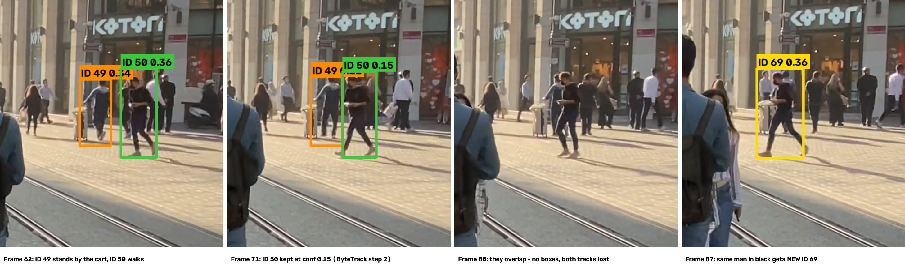

# Week 4: Person Tracking with ByteTrack

This adds a tracker to my Week 2 YOLO person detector. Each person gets an ID that stays the same across frames. The script counts unique people with tracking, compares that with a manual count and finds ID switches.

## What it does

1. Runs `yolo11n` on every frame, keeping only people (COCO class 0).
2. Uses `model.track(frame, persist=True, classes=[0], tracker="bytetrack.yaml")` to give each person an ID. `persist=True` keeps IDs between frames.
3. Draws each person's box with the label `ID <n> <confidence>`, using one colour per ID, and a trail of their path.
4. Shows the frame number, people in view and unique IDs so far at the top of the video.
5. Counts unique people by storing every ID in a set: `count = len(seen_ids)`.
6. Logs every ID in every frame to a CSV and flags likely ID switches: a new ID that appears where another ID of similar size was lost a moment before.

## How to run

```bash
pip install -r requirements.txt
python track_people.py
```

Put the video in this folder as `input.mp4` first.

## Outputs

| File | What it is |
|---|---|
| `output_tracked.mp4` | Video with IDs, boxes, trails and the counter |
| `track_log.csv` | One row per person per frame: frame, time, ID, confidence, box |
| `id_summary.csv` | One row per ID: first frame, last frame, frames seen |
| `switch_candidates/` | Snapshot of each likely ID switch; the white box is where the old ID was last seen |

## Video

A 9.3-second clip of a busy pedestrian street, filmed in portrait (2160×3840, 30 FPS, 279 frames) by someone walking with the crowd, so **the camera is moving**. The tracker sees 7 to 13 people in each frame. Some people walk right in front of the camera, and a large crowd is far away in the background.

## Results

| | Count |
|---|---|
| Manual count (about) | **25** |
| Unique IDs from the tracker (`len(seen_ids)`) | **44** |
| Unique IDs that lasted 1 second or more | **19** |
| Difference (tracker − manual) | **+19** |

**How I counted by hand:** I counted every person who is clearly visible at some point in the clip: the people walking near the camera and in the middle of the street, including people who pass the camera at the edges. I did not count the crowd far in the background, because they are too small to count reliably. Because the street is so crowded, this count is approximate (about ±3).

### Why the counts are different

The tracker counted 44 unique IDs, but I counted about 25 people, so the tracker counted about 19 too many.

**Reasons the tracker count is too high:**
- **Tracks kept breaking.** 25 of the 44 IDs lasted less than 1 second. Far-away people have small boxes and low confidence (often 0.15–0.35), so the detector loses them for a few frames, and when they come back they often get a new ID. The ID switch below is an example.
- **The camera is moving.** Everything in the frame shifts as the person filming walks. ByteTrack predicts where each person will move from their own motion only, so camera movement makes its predictions worse. BoT-SORT (the Ultralytics default) corrects for camera motion; ByteTrack does not.

**Reasons the tracker count is too low:**
- **Most of the far background crowd is never detected.** Those people are too small for `yolo11n`, which is the "far away" failure from Week 3.
- **People hidden behind others in the crowd** are never detected, or only for a moment.

**What worked well:** people close to the camera were tracked well. IDs 1, 2, 3, 6 and 7 kept the same ID for the whole video (273–279 of 279 frames). Many different people pass the camera on the left edge, partly cut off by the frame (e.g. IDs 51, 72, 88, 94, 97, 109). These are real people, but their tracks are short because they leave the frame quickly.

Counting only IDs that lasted at least 1 second gives 19. That is below my count of about 25: it removes most of the broken tracks, but it also removes real people who were only in view briefly. So the true number is between the two tracker numbers, and neither is right on its own.

## ID switch



- **Frame:** 87 (2.9 s)
- **What happened:** Two men far away in the street: **ID 49** (grey hoodie, next to a white cart) and **ID 50** (black T-shirt, walking). At frame 71, ID 50's confidence drops to 0.15, but ByteTrack still keeps his ID; this is ByteTrack's second step, matching low-confidence boxes, working. From frame 72 to 86, ID 50 walks in front of ID 49. While they overlap, the detector finds neither of them, so both tracks are lost. At frame 87, the man in black comes out on the other side and is detected again, but he gets a **new ID, 69**, instead of 50. ID 69 itself is lost again at frame 92.
- **Why I think it happened:**
  1. **They crossed paths.** One person blocked the other, so the detector missed both of them for 16 frames. This is the first cause of ID switches from the lecture.
  2. **He is far away and small.** His box is only about 65–95 px wide in a 2160 px wide frame, and his confidence is only 0.15–0.36. In those 16 frames he moved about 70 px, roughly one box width, so his new box barely overlapped where the tracker expected him. ByteTrack matches by box overlap and multiplies it by confidence, so a low-confidence box needs a very large overlap to match. ByteTrack started a new ID instead.
  3. **ByteTrack does not compare appearance.** It only uses motion and box overlap. DeepSORT also compares how a person looks, and it could have recognised his black T-shirt and kept ID 50.
- **Note:** the automatic switch finder (`switch_candidates/frame00087_ID49_to_ID69.jpg`) linked ID 69 to **ID 49**, because ID 69 appeared where ID 49 had been standing. Watching the frames showed it was really **ID 50**. The finder only suggests candidates; each one has to be checked by eye.

## Notes

- **No confidence threshold is passed to the tracker.** In Week 3 I used 0.4, but ByteTrack's second step matches low-confidence boxes to the tracks left over, which keeps partly hidden people from being lost. Frame 71 above shows this: ID 50 is kept at confidence 0.15. Ultralytics passes boxes down to 0.1 to the tracker, and ByteTrack only starts a new ID from a box at 0.25 or above.
- **ID numbers skip** (my IDs go up to 202 even though there are only 44). ByteTrack uses up an ID number for short detections it never confirms. This is why the count uses `len(seen_ids)` and not the highest ID number.
- **ByteTrack vs BoT-SORT:** the Ultralytics default tracker is BoT-SORT. I chose ByteTrack (`tracker="bytetrack.yaml"`) because it is fast and handles partly hidden people well.
- The output is re-encoded to H.264 with `imageio-ffmpeg` so it plays in browsers, VS Code and Windows. If OpenCV cannot read the input video (for example HEVC from a phone), the script converts it to `input_h264.mp4` first.
